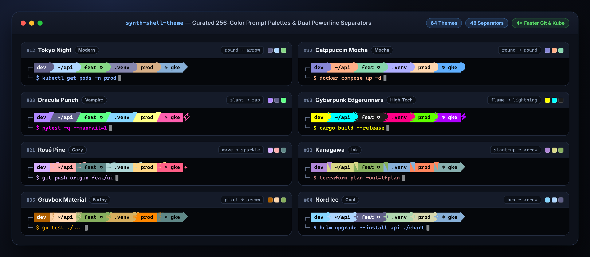
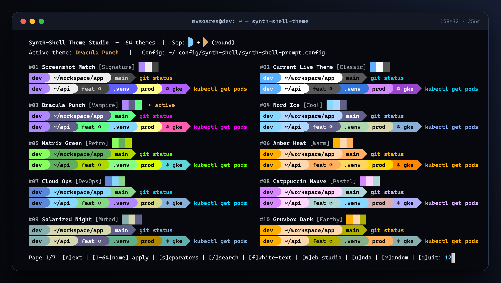
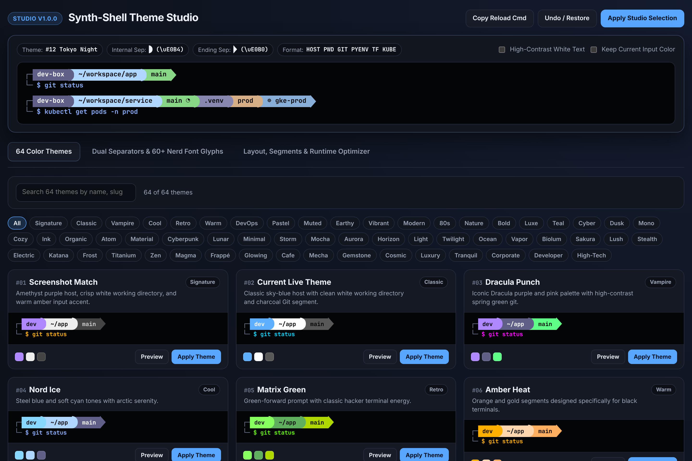
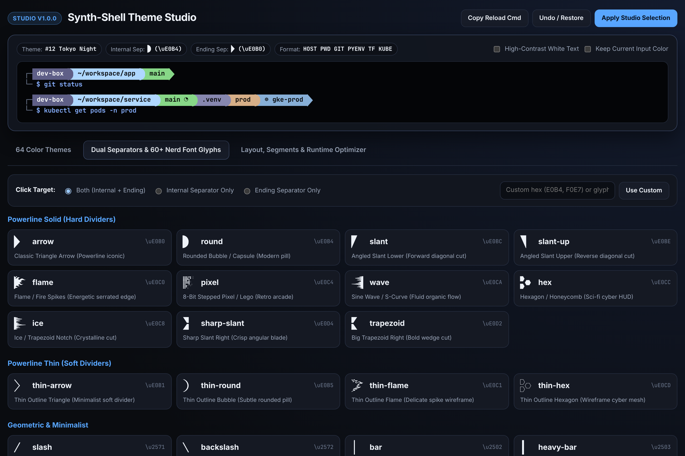
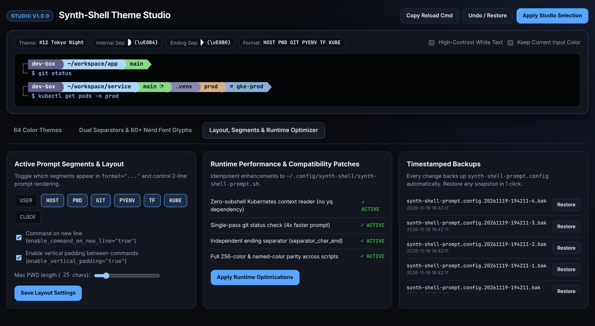
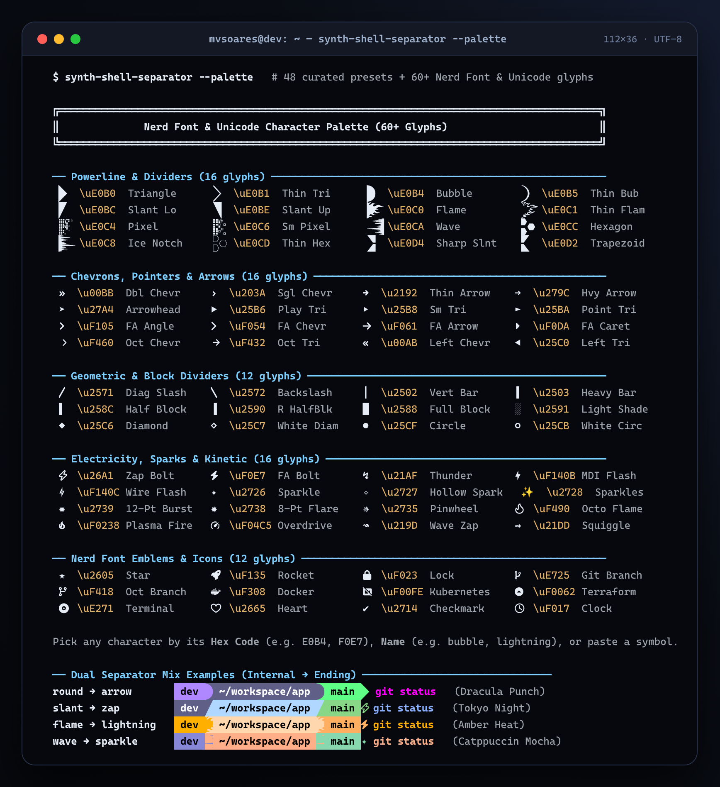

# ✦ Synth-Shell Theme Studio (`synth-shell-theme`)

[](https://github.com/mvsoares/synth-shell-theme/actions/workflows/ci.yml)
[](https://pypi.org/project/synth-shell-theme/)
[](https://github.com/mvsoares/synth-shell-theme/releases)
[](https://www.python.org/)
[](https://github.com/mvsoares/synth-shell-theme)
[](https://github.com/mvsoares/synth-shell-theme/blob/main/LICENSE)

Interactive **256-color Prompt Theme Picker (64 themes)**, **Dual Powerline Separator Editor (48 presets + 60+ Nerd Font glyphs)**, **Runtime Speed Optimizer**, and **Live Web Studio** for [synth-shell](https://github.com/andresgongora/synth-shell).

Built with **100% Python `>= 3.10` standard library** — **zero external runtime dependencies**.

<p align="center">
  
</p>

---

## Features

- **64 Curated 256-Color Prompt Themes**: From *Tokyo Night*, *Catppuccin Mocha/Latte/Frappé/Mauve*, *Dracula Punch*, *Rose Pine*, *Kanagawa*, *Everforest*, *Gruvbox*, and *Cyberpunk Edgerunners* to *Cloud Ops*, *GitHub Dark*, and *Minimal Mono*.
- **Side-by-Side Terminal UI (`synth-shell-theme`)**: 2-column 256-color live terminal preview rendering both 3-segment and 6-segment DevOps prompts (`host · pwd · git · pyenv · tf · kube`), live search (`/term`), high-contrast white-text mode (`[f]`), and 1-key undo (`[u]`).
- **Dual Powerline Separator Editor (`synth-shell-separator` or `synth-shell-theme sep`)**: Mix independent **internal** (`separator_char`) and **ending** (`separator_char_end`) glyphs across **48 curated presets** in 6 categories plus a **60+ Nerd Font Character Matrix**.
- **Live Browser Web Studio (`synth-shell-theme web`)**: Local HTTP studio (`http://127.0.0.1:7778`) with a sticky live prompt workbench, category badge filtering, 1-click theme & dual-separator application, segment order toggles (`USER HOST PWD GIT PYENV TF KUBE CLOCK`), and backup history.
- **4 Idempotent Runtime & Performance Patches (`synth-shell-theme init`)**:
  1. **Zero-subshell Kubernetes context (`kube_fast`)**: Reads `$KUBECONFIG` / `~/.kube/config` directly in pure Bash (<1 ms, removes `yq` dependency, shortens GKE context names).
  2. **Single-pass Git status (`git_single_pass`)**: Consolidates 3 `git status` invocations into a single `git status --porcelain -b` call (**4× faster prompt** in large repositories).
  3. **Independent Ending Separator (`dual_separator`)**: Extends `printSegment()` and `combine_elements()` to honor `separator_char_end` right before typed input.
  4. **Full 256-Color Parity (`color_256_parity`)**: Upgrades `getColorCode()` and `getBackgroundCode()` across `synth-shell-prompt.sh`, `alias.sh`, `better-ls.sh`, and `better-history.sh` so indices `0`–`255` and all 16 named colors render identically.
- **Safe Atomic Writes & Backups**: Preserves your custom layout, padding, and Git symbols when switching colors, with automatic timestamped backups in `~/.config/synth-shell/backups/` and portable JSON presets (`export` / `import`).

---

## Screenshots

### Interactive 2-Column Terminal Picker (`synth-shell-theme`)

Browse all 64 palettes side-by-side in your terminal with live 256-color swatches, 3-segment & 6-segment DevOps prompt previews, instant `/search`, and 1-key theme switching:

<p align="center">
  
</p>

### Live Browser Web Studio (`synth-shell-theme web`)

Prefer a visual workbench? Launch the zero-dependency local Web Studio to preview themes, mix dual Powerline separators, reorder prompt segments, and manage runtime speed patches & backups in 1 click:

<p align="center">
  
</p>

<table>
  <tr>
    <td width="50%" align="center">
      <strong>Dual Separators &amp; 48 Curated Presets</strong><br /><br />
      
    </td>
    <td width="50%" align="center">
      <strong>Segment Toggles, Runtime Optimizer &amp; Backups</strong><br /><br />
      
    </td>
  </tr>
</table>

### 60+ Nerd Font & Dual Separator Cheat-Sheet (`synth-shell-separator --palette`)

Mix any internal divider (e.g. rounded capsule, diagonal slant, wave, pixel) with an independent ending cap (e.g. classic arrow, lightning bolt, diamond sparkle):

<p align="center">
  
</p>

---

## Installation

### From PyPI (`pipx`, `uv`, or `pip`)

```bash
# Recommended: pipx
pipx install synth-shell-theme

# Or via uv (persistent tool install)
uv tool install synth-shell-theme

# Zero-install instant run with uvx
uvx synth-shell-theme

# Or via pip
pip install --user synth-shell-theme
```

### Local Clone / Editable Development Install

```bash
git clone https://github.com/mvsoares/synth-shell-theme.git
cd synth-shell-theme
pipx install -e . --force
```

Both `synth-shell-theme` (primary CLI) and `synth-shell-separator` (dedicated separator editor) are installed onto your `PATH`.

### Initialize Runtime Enhancements

After installing `synth-shell` (or use `--install` to install upstream `synth-shell` automatically), apply the 4 runtime speed & compatibility patches once:

```bash
synth-shell-theme init
# Or install upstream synth-shell + patch + apply Tokyo Night (#12):
synth-shell-theme init --install --apply tokyo-night
```

---

## Quick Start

### 1. Interactive Terminal Picker (TUI)

```bash
synth-shell-theme
```

Keyboard shortcuts inside the TUI:
- `1`–`64` or theme name/slug — Apply theme immediately
- `n` / `p` / `g <page>` — Next, previous, or jump to page
- `/query` — Filter themes by name, slug, or badge (`c` to clear)
- `s` — Open the interactive **Dual Separator & 60+ Glyph Editor**
- `f` — Toggle **High-Contrast White Text** (`--force-white-text`)
- `k` — Toggle **Keep Current Input Color** (`--keep-input`)
- `w` — Launch the **Live Web Studio** in your browser
- `b` / `u` — Save a manual backup or undo/restore the latest backup
- `r` — Apply a random theme

### 2. Live Browser Web Studio

```bash
synth-shell-theme web
# Custom port or headless mode:
synth-shell-theme web --port 7778 --no-browser
```

### 3. Direct CLI Commands

```bash
# List all 64 themes with 256-color Host/PWD/Git swatches
synth-shell-theme --list

# Apply a theme by number, name, or slug
synth-shell-theme --apply 12
synth-shell-theme --apply catppuccin-mocha
synth-shell-theme --apply dracula-punch --force-white-text --keep-input

# Dual Powerline & Nerd Font separators
synth-shell-theme --dual round arrow        # Rounded bubbles inside + classic triangle cap
synth-shell-theme --dual slant zap          # Cyberpunk slant inside + lightning bolt at end
synth-shell-separator --palette             # Print 60+ Nerd Font glyph cheat-sheet
synth-shell-separator                       # Launch dedicated interactive separator editor

# Prompt layout options
synth-shell-theme --format "HOST PWD GIT PYENV TF KUBE" --two-line

# Health check, backups & portable presets
synth-shell-theme doctor
synth-shell-theme --restore
synth-shell-theme export my-prompt.json
synth-shell-theme import my-prompt.json
```

Reload your active Bash session after applying changes:

```bash
source ~/.config/synth-shell/synth-shell-prompt.sh
```

---

## Environment Variables

| Variable | Description |
| :--- | :--- |
| `SYNTH_SHELL_CONFIG_DIR` | Override configuration directory (defaults to `~/.config/synth-shell`). |

---

## Development & Testing

```bash
python3 -m unittest discover -s tests -v
```

---

## License

MIT License — see [LICENSE](https://github.com/mvsoares/synth-shell-theme/blob/main/LICENSE).
